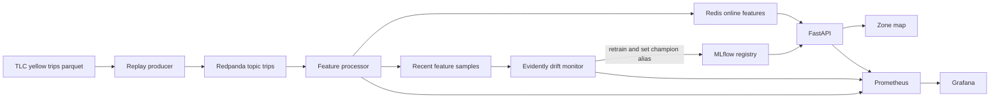

# Surgecast

Live NYC yellow-taxi demand forecasting. Trip records are replayed into Redpanda, turned into per-zone rolling features, and scored by a LightGBM model served from the MLflow registry. The same feature function is used to build the training set and to update Redis.

Owner: Ishan Singh Tomar.

This repository does not use a language model at runtime. Forecasting is tabular gradient boosting plus a small PyTorch MLP that is trained only as a comparison and is not served.

## Architecture



`docker compose up` starts Redpanda, Redis, MLflow, the feature processor, the drift monitor, the API, Prometheus, Grafana, and a built copy of the map. The replay producer is a separate `make replay` so you can choose the speed and the slice.

## Measured results

<!-- MEASURED:START -->

## Resume bullets

No measurements have been recorded yet. Run `python -m surgecast.bench.run` after `make train`. Until that command finishes, do not treat any forecast error, latency, or throughput figure as known.

<!-- MEASURED:END -->

Full tables, including sections that could not be run, are written to `RESULTS.md`. Raw values are in `results/benchmark.json`.

## Setup

Requirements: Docker with Compose v2, Python 3.12, and about 8 GB of free RAM for a full month of yellow-taxi trips. The Python packages are in `requirements.txt`. The service image uses `requirements-prod.txt`.

```bash
python3 -m venv .venv
.venv/bin/pip install -r requirements.txt
make download-data
# MLflow UI and registry. Leave this running.
make mlflow
# In another shell, with MLFLOW_TRACKING_URI=http://127.0.0.1:5055
make train
make up
make replay SPEED=0
```

The map dev server proxies `/api` to the API:

```bash
cd frontend && npm install && npm run dev
```

Dev map: `http://127.0.0.1:43123`. Compose serves the built map on `http://127.0.0.1:43124`. API: `http://127.0.0.1:8841`. Grafana: `http://127.0.0.1:3333` (anonymous view, local admin `admin` / `admin`). MLflow: `http://127.0.0.1:5055`. Prometheus: `http://127.0.0.1:9095`.

Other targets:

| Target | What it does |
| --- | --- |
| `make download-data` | Yellow trips for January 2024 and the zone lookup CSV |
| `make train` | Bucket counts, LightGBM 15/30 min models, baselines, optional MLP, MLflow registry |
| `make replay SPEED=60` | Replay trips. `0` publishes as fast as the client can. `60` is 60x event time |
| `make inject-drift SHOCK=3 START=2024-01-29T00:00:00 END=2024-01-29T12:00:00` | Re-publish that window with 3 copies of each trip |
| `make load-test` | Locust against the API |
| `make benchmark` | Writes `RESULTS.md` from whatever is actually running |
| `make test` / `make lint` | pytest and ruff |

`make up` bind-mounts `mlflow.db` and `mlartifacts`, so models registered against the local server are the models the API loads. Stop the host MLflow process before `make up` if both would open the same SQLite file.

## Data

- Trips: [TLC yellow trip records, January 2024](https://d37ci6vzurychx.cloudfront.net/trip-data/yellow_tripdata_2024-01.parquet), columns `tpep_pickup_datetime` and `PULocationID`.
- Zone names: [taxi zone lookup](https://d37ci6vzurychx.cloudfront.net/misc/taxi_zone_lookup.csv).
- Polygons: TLC taxi zone shapefile, reprojected to WGS84 and simplified for the map. The GeoJSON is in `frontend/public/taxi_zones.geojson`.

Pickup timestamps are America/New_York wall times. The file stores them as `datetime64[us]`. Bucket 0 opens at 2024-01-01 00:00 EST. Rows outside January 2024 or zones outside 1–263 are dropped.

## Design decisions

**One feature function.** `surgecast.features.compute.feature_rows` is the only place that turns a zone's bucket counts into a model vector. Offline training loops it across history. The stream processor calls it when a bucket closes. A decision at bucket `t` reads only counts before `t` and forecasts `t` through `t+2` (15 minutes) or `t+5` (30 minutes). Tests check a hand-built window, check that future counts do not leak, and check that the online counter matches the batch aggregation.

**Five-minute buckets.** Rolling 5/15/30/60 minute counts, the previous 15 and 60 minutes, the same 15/30 minute window yesterday and last week, a delta, a trend ratio against the last hour, and local hour, weekday, weekend, and 15-minute slot. The first week is warmup so the weekly seasonal feature is defined. Training starts at 2024-01-08. Validation is 2024-01-26 and 2024-01-27. The test set starts 2024-01-28. The split is by decision time, not by a random row shuffle.

**One global model per horizon, zone id as a category.** A separate model for each of the 263 zones throws away shared time-of-day structure and leaves sparse zones with almost no rows. Forecasts are still emitted per zone. LightGBM is the served model. A small PyTorch MLP (zone embedding, two hidden layers) is trained on the same split when PyTorch imports, logged to MLflow, and not promoted.

**Baselines.** Last value uses the trailing 15-minute count for the 15-minute horizon and the trailing 30-minute count for the 30-minute horizon. Seasonal naive uses the same window yesterday. Predictions are clipped at zero in evaluation and in the API, in `clip_prediction`.

**Redpanda, one partition.** The broker speaks the Kafka protocol and runs as a single container. One partition keeps the replay in pickup-time order, which is what the watermark assumes. A late event still increments its bucket, but it does not move the watermark backward. The processor counts those events.

**Drift is a ratio, not a raw count.** Comparing raw pickup counts to a training sample flags ordinary time-of-day changes. The monitor builds `pu_15m / (seasonal_yday_15 + 1)` and the 30-minute twin, then runs Evidently's PSI test with threshold 0.2 and a drifted-column share of 0.5. A demand shock moves today's count before yesterday's seasonal feature catches up, so the ratio moves. On a positive result, and outside a 10-minute cooldown, the drift service retrains both LightGBM models on the live bucket counts, registers them, and points the `champion` alias at the new versions. The API checks the alias every two seconds and swaps the in-memory boosters. It does not call MLflow on the request path.

**Shock injection.** `make inject-drift` republishes a time window with N copies of each trip. Use a window the main replay has not published yet. Republishing a window that is already behind the watermark updates memory but does not refresh Redis.

**Metrics.** Prometheus histograms and gauges cover events produced, events consumed, consumer lag, feature-update latency, API latency, online absolute error, drift score, and model version. Grafana loads `infra/grafana/dashboards/surgecast.json` at startup.

## Tests and CI

`pytest` covers the feature windows, the microsecond timestamp conversion, regression metrics, Evidently's no-drift and shock-drift outcomes, the retrain trigger cooldown, a real MLflow alias promotion, and the API including a hot swap. `.github/workflows/ci.yml` installs `requirements.txt`, runs ruff, and runs pytest. The workflow does not start Docker.

## What is intentionally out of scope

No authentication, no multi-node Kafka, and no separate model per zone. The PyTorch network is a comparison run. The map is a Leaflet view of the official taxi zones, not a deck.gl scene.
